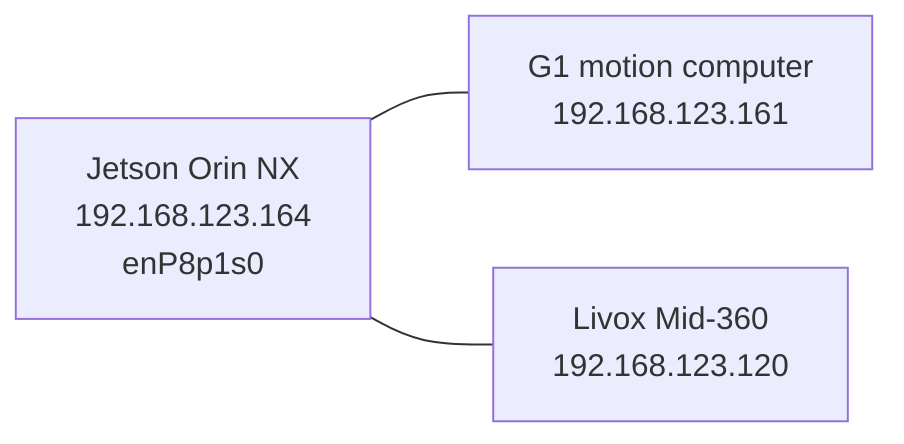

# G1 architecture

Observed on `unitree-g1-nx` on 2026-10-29. The onboard computer is the Jetson Orin NX described in `robot/g1/machine.md`. Robot Ethernet is `enP8p1s0` at `192.168.123.164/24` (1 Gbps). DDS to the motion computer and the Livox stream both use that link, not USB and not Wi-Fi.

| Address | Device | Role |
|---------|--------|------|
| `192.168.123.164` | This computer (`enP8p1s0`, MAC `3c:6d:66:1f:73:e1`) | Onboard computer. DDS client and Livox host. |
| `192.168.123.161` | G1 motion computer (MAC `7e:1d:75:60:f5:89`) | Sport services and odometry over DDS. |
| `192.168.123.120` | Livox Mid-360 (MAC `58:b8:58:98:f6:1c`) | Lidar. Not a USB device. |

## Livox Mid-360

The Mid-360 is connected and streaming on the robot Ethernet link. Nothing that looks like a lidar is on USB. The other USB devices are a RealSense 435i, an FTDI serial adapter, a camera, Wi-Fi, and a cellular modem.

| Stream | Rate | UDP port |
|--------|------|----------|
| Point cloud, Cartesian | about 200,000 points/s | 56300 |
| IMU | about 200 Hz | 56400 |
| Status push | 1 Hz | 56200 |

The driver config at `robot-nav/src/go2_nav/config/MID360_config.json` still lists the lidar at `192.168.123.20` and the host at `192.168.123.18`. Those addresses are not on the network. The live lidar is already sending data to this computer at `192.168.123.164`.

The cloud is in `livox_frame`. `g1_rtabmap.launch.py` publishes `base_link` → `livox_frame` from `src/g1_nav/config/g1_rtabmap.yaml`. The Mid-360 is mounted upside down, so that rotation is roll 180° (sensor +Z points at the floor; the roll turns it up in `base_link`). On 2026-10-30 the dominant horizontal plane in that frame sat at `z=-0.152` with the placeholder height `1.10`. `lidar.z` is `1.252`, so the floor is at `z=0` in `base_link`. The plane normal was about `(0.03, 0.01, 1)`.

Sport `/odom` places that frame at the pelvis height in the sport datum. After the 2026-10-30 odom reset the pelvis was at `z=0.110` and, with `lidar.z=1.252`, the floor plane in that frame was at `z=0.110` (normal about `(0.02, -0.01, 1)`, inlier span 0.14 m). `g1_odom_tf` subtracts `odom_z_offset` from that same YAML file (`0.110`) so the floor is `z=0` in the map frame. `Grid/MapFrameProjection` classifies ground against that origin. Re-run `src/g1_nav/utils/fit_ground.py` after the next odom reset and write the printed offset back into the YAML file.

## Odometry

`robot-bridge` republishes the Unitree DDS poses. It does not broadcast TF. `g1_nav`'s `g1_odom_tf` copies `/odom` onto `/tf` as `odom` → `base_link`, minus `odom_z_offset` on z. Lidar-only RTAB-Map uses that transform with `/livox/lidar`.

| ROS topic | Unitree topic | Child frame |
|-----------|---------------|-------------|
| `/odom` | `rt/odommodestate` (sport, "Odom mode") | `base_link` |
| `/odom/pelvis` | `rt/state_estimator/odom_pelvis` | `pelvis` |
| `/odom/torso` | `rt/state_estimator/odom_torso` | `torso` |
| `/odom/fusion` | `rt/state_estimator/fusion_odom` | `base_link` |
| `/odom/fusion_torso` | `rt/state_estimator/fusion_odom_torso` | `torso` |

`/odom` is the pelvis pose, not the torso. Sampled 2026-10-30: `/odom` and `/odom/pelvis` were the same position and orientation (`x=1.243`, `y=1.201`, `z=1.822`). `/odom/torso` was about 5 cm higher (`z=1.876`). The sport message labels the child frame `base_link`, but the numbers match the pelvis estimator.

`/odom/fusion` and `/odom/fusion_torso` had publishers and no messages, so they are not the pose used for mapping.
