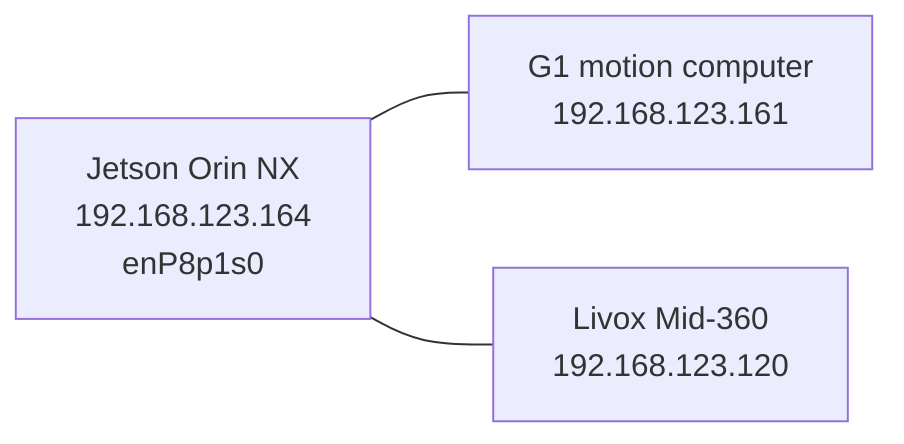

# G1 architecture

Observed on `unitree-g1-nx` on 2026-10-29. The onboard computer is the Jetson Orin NX described in `robot/g1/machine.md`. Robot Ethernet is `enP8p1s0` at `192.168.123.164/24` (1 Gbps). DDS to the motion computer and the Livox stream both use that link, not USB and not Wi-Fi.

| Address | Device | Role |
|---------|--------|------|
| `192.168.123.164` | This computer (`enP8p1s0`, MAC `3c:6d:66:1f:73:e1`) | Onboard computer. DDS client and Livox host. |
| `192.168.123.161` | G1 motion computer (MAC `7e:1d:75:60:f5:89`) | Sport services and odometry over DDS. |
| `192.168.123.120` | Livox Mid-360 (MAC `58:b8:58:98:f6:1c`) | Lidar. Not a USB device. |

## Livox Mid-360

The Mid-360 is connected and streaming on the robot Ethernet link. Nothing that looks like a lidar is on USB. The other USB devices are a RealSense 435i, an FTDI serial adapter, a camera, Wi-Fi, and a cellular modem.

| Stream | Rate | UDP port |
|--------|------|----------|
| Point cloud, Cartesian | about 200,000 points/s | 56300 |
| IMU | about 200 Hz | 56400 |
| Status push | 1 Hz | 56200 |

The driver config at `robot-nav/src/go2_nav/config/MID360_config.json` still lists the lidar at `192.168.123.20` and the host at `192.168.123.18`. Those addresses are not on the network. The live lidar is already sending data to this computer at `192.168.123.164`.
